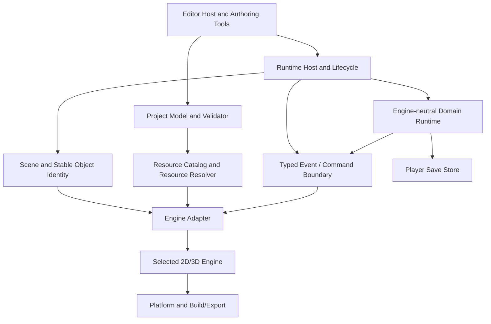

# Runtime Architecture Plan — 2026-11-14

- **Status:** Proposed implementation plan; not an accepted foundation decision.
- **Owner:** Engine Architecture & Runtime.
- **Baseline:** `main` at `9404f31b9d5536879d27a4da1d52c69b7dd42612`.
- **Related proposal:** ADR 0001 remains Proposed; PRs #2, #3, and #4 remain unmerged proposals.
- **Purpose:** Define testable subsystem boundaries and the next evidence-producing work without prematurely selecting an engine or creating placeholder crates.

## 1. Audit findings

The inspected `main` branch contains product/architecture documentation only. It has no `Cargo.toml`, Rust source, runtime, editor, sample project, test harness, or GitHub Actions workflow. There is no implemented ECS, scene loader, resource manager, renderer, physics integration, scripting host, or export pipeline.

The repository documents one architecture ADR: `docs/architecture/decisions/0001-engine-foundation.md`. Its status is **Proposed**, not Accepted. No additional ADR path was referenced by the inspected README or ADR index (there is no ADR index in the inspected files); a complete repository-tree listing was not available through the connected GitHub interface, so this report does not claim an exhaustive filesystem enumeration of every possible ADR file.

### Open proposals

| PR | Scope | Current interpretation |
|---|---|---|
| #2 | Narrative Document and Player Save contract | Story-owned proposed data contract; not runtime implementation |
| #3 | Fyrox 1.0.1 vs Bevy 0.20.1 evidence | Useful comparison; no runnable candidate spike and no selection |
| #4 | Project Manifest v1 | Runtime-owned proposed manifest; no loader or scene format |

All three are open, target `main`, and are unmerged. Their schemas/fixtures are design artifacts, not runtime behavior. Do not implement against them as immutable public APIs before cross-stream review.

The latest inspected main commit is `9404f31` (2026-11-13). The repository has no open issues at the time of this audit. The two Runtime-owned open PRs are #3 and #4; #2 belongs to Story & Editor. No Runtime code branch exists in the inspected branch search other than those PR branches.

## 2. Technology assessment and current recommendation

### Language

**Provisional recommendation: stable Rust as the default implementation language.**

Rust's ownership model, enums, traits, type system, package tooling, and native performance fit a long-lived engine core with many independently developed subsystems. It also gives the project a single language for runtime, project tooling, editor host, and build tools. This is a direction already proposed in ADR 0001, not a final compiler/toolchain pin.

C++ remains an allowed interoperability option, not a co-equal default. Introduce it only for a named subsystem when a required mature library has no reasonable maintained Rust alternative or when a measured compatibility/performance requirement justifies it. The boundary must be a narrow C ABI with explicit ownership, lifetimes, threading, error translation, versioning, license review, and integration tests. Do not expose C++ object layouts or exceptions across the boundary.

| Criterion | Rust | C++ |
|---|---|---|
| Runtime performance | Native; suitable for engine workloads | Native; suitable for engine workloads |
| Memory safety | Strong compile-time ownership and borrowing guarantees | Greater manual lifetime and ownership burden |
| Ecosystem | Strong native engine ecosystem, but some integrations require FFI | Broadest legacy/native engine and middleware ecosystem |
| Editor/tooling | Strong Cargo tooling and reusable Rust UI ecosystem | Mature GUI choices, but adds build and ABI complexity |
| Integration risk | Crate/API churn and occasional platform/native build friction | ABI, allocator, exception, and toolchain boundary complexity |
| SEngine position | Default pending spike | Exception for evidence-backed native integration |

### Engine foundation

Do **not** select Fyrox or Bevy from feature lists alone.

- **Fyrox 1.0.1:** strongest immediate candidate for a working 2D/3D scene editor and integrated project workflow. The primary risk is whether SEngine can add its Story Map, dialogue tools, gameplay graph, timeline, preview/debugger, and custom project semantics without invasive editor forks or shipping editor-only dependencies.
- **Bevy 0.20.1:** strongest candidate for a modular, engine-neutral runtime and headless ECS integration. The primary cost is that SEngine must own and maintain a substantial editor shell and authoring workflow; the documented MSRV is also higher and the API has a faster breaking-change cadence.
- **Build internally:** build SEngine-specific project identity, narrative host integration, typed graph semantics, diagnostics, migration policy, and stable public subsystem contracts. Do not build a custom renderer, ECS, physics engine, audio mixer, or GPU backend unless the spike exposes a concrete requirement that existing engines cannot satisfy.

**Decision:** no foundation selected. Run the same bounded vertical-slice spike against both exact candidate versions, using Rust 1.97.1 or a newer pinned stable toolchain that both candidates support. Record build time, memory, runtime dependency graph, editor extension effort, headless behavior, standalone export, platform prerequisites, and complete dependency license/advisory results. The existing comparison report in PR #3 is a useful research baseline, not a substitute for that execution.

## 3. Proposed logical architecture

The architecture is layered. Domain data and runtime contracts remain engine-neutral; engine-specific adapters sit at the edge.

The diagram is a proposed dependency direction, not a claim that these components exist. In particular, narrative and gameplay-graph semantics remain owned by their respective streams and are not implemented in this Runtime plan.

### 3.1 Core and lifecycle

Core owns only cross-cutting primitives that have multiple real consumers: stable ID types, structured diagnostics, version metadata, logging/tracing facade, error conventions, and lifecycle coordination. It must not become a dumping ground for gameplay features.

Runtime lifecycle should expose explicit states and transitions: initialize, load project, prepare scene, start, pause/resume, stop, and shutdown. Startup/shutdown ordering must be deterministic; failures must identify the subsystem and phase. Headless mode must not initialize windowing, rendering, audio devices, or editor services.

### 3.2 Project system

The project service owns project discovery, manifest parsing, structural and semantic validation, path resolution, stable project/resource IDs, migration dispatch, and dirty-state notifications. It does not own player saves, editor layout, renderer handles, or engine entity IDs.

The proposed PR #4 manifest is a candidate contract. Before acceptance, review whether asset catalog arrays, path normalization/case folding, symlink policy, and the entry-scene rule are portable and implementable on supported filesystems. Path containment must be enforced by the loader after canonical filesystem resolution, not by JSON Schema alone.

### 3.3 Scene and object identity

The SEngine scene model owns persistent scene/object IDs, hierarchy, parent references, transform data, and resource references. The selected engine owns transient runtime objects, render handles, and engine-specific scene instances.

Maintain an explicit mapping:
- persistent `SceneObjectId` -> runtime engine entity/node handle;
- persistent `AssetId` -> loaded resource handle;
- runtime handles never serialize as project identity.

The scene contract is a separate decision from the project manifest. Do not define scene contents until the engine spike establishes the minimum common object model and serialization boundary.

### 3.4 ECS and component model

Do not introduce a custom ECS before choosing the foundation. If Bevy is selected, use Bevy ECS as the runtime storage/scheduling mechanism behind SEngine-owned adapter traits where needed. If Fyrox is selected, first test its scene/node/component model and avoid maintaining a parallel ECS unless a measured use case requires one.

In either case:
- persistent identity is owned by SEngine project data, not ECS indices;
- editor selection and inspector state remain outside runtime components;
- cross-system communication uses typed messages/commands or explicit service APIs, not global mutable singletons;
- system scheduling and thread-affinity requirements are documented;
- domain components must not leak engine-specific types into serialized project data.

### 3.5 Resource management

Resource service owns stable asset IDs, source paths, import metadata, dependency references, load state, and diagnostics. The engine adapter owns decoded/GPU/native resource handles and their destruction rules. Derived caches are disposable and keyed by source content plus importer/version settings. Asset import workers must not mutate live scene state directly; they publish completion/failure results through a defined boundary.

PR #4 only defines a coarse asset catalog. It does not define importers, dependency graphs, cache keys, generated artifacts, or platform variants.

### 3.6 Rendering integration

Rendering is delegated to the selected engine initially. SEngine owns only engine-neutral scene presentation intent and editor/runtime viewport coordination. No direct `wgpu` backend or custom renderer should be started before the engine spike.

The adapter must define how a scene is attached, how camera/viewport dimensions are updated, how resources are resolved, and how rendering diagnostics reach the editor. A headless target must compile without creating a graphics context.

### 3.7 Physics integration

Physics belongs to the Physics & Simulation stream. Runtime owns only the host boundary: scene object identity mapping, fixed-step/update scheduling contract, collision/trigger event delivery, and serialization ownership. The physics stream chooses and tests the implementation. Do not create a second physics world in Runtime or expose engine-private body handles as persistent IDs.

### 3.8 Event and command system

Use typed, versionable messages at subsystem boundaries. Distinguish:
- **Commands:** requests to mutate a subsystem, with an explicit result/error.
- **Events:** facts that have already occurred, delivered with defined ordering and ownership.
- **Queries:** read-only requests that do not mutate state.

The host owns event dispatch. Domain systems must not directly call editor panels, renderer internals, or other stream implementations. The Narrative contract's FIFO event output is a useful proposed domain rule; the runtime host must define when those events are consumed and how scene/timeline/interaction adapters respond. Cross-thread delivery must specify queueing, ordering, and shutdown behavior.

### 3.9 Plugins and extensions

Defer a public third-party plugin ABI and marketplace. Initially use compile-time Rust modules/internal extension registration for first-party systems. A public plugin API requires a compatibility/versioning and trust model, and Rust trait objects are not a stable cross-version ABI. If dynamic native plugins become necessary, evaluate a versioned C ABI or a sandboxed scripting/wasm boundary separately.

### 3.10 Serialization and saves

Separate at least three data domains:
1. **Project authoring data:** project, scenes, assets, graph/narrative definitions, stable IDs, schema versions.
2. **Player save data:** mutable player progress/state, versioned independently and validated against authoring data.
3. **Editor session data:** layout, selection, zoom/pan, recent files; disposable and never required to run a game.

All persistent formats require explicit versions, deterministic validation, migration fixtures, stable IDs, and no silent partial restore. The project manifest and narrative proposal already follow the project/save separation principle; their schemas still need cross-stream compatibility review.

### 3.11 Build and export

Keep editor tooling and game runtime targets separate at the dependency-feature level. Export should consume a validated project, resolve only referenced runtime assets/plugins, build a standalone player, and emit a manifest of included resources and target requirements. Do not promise platforms until a clean build and packaged launch test pass on each target.

### 3.12 Editor-to-runtime communication

Start with an in-process Rust API and typed command/event boundary when the editor and preview runtime share a process. Do not introduce IPC prematurely. If hot-reload, crash isolation, remote preview, or separate processes later require IPC, serialize the same versioned messages over a transport; do not create a second semantic API. Runtime must never depend on editor widget crates.

## 4. Cross-stream contracts

| Stream | Runtime-owned contract required | Stream-owned behavior |
|---|---|---|
| Story Systems & Editor | Stable project/document/resource references; typed host commands/events; diagnostic envelope; preview lifecycle | Dialogue semantics, story graph data, authoring UI, debugger presentation |
| Visual Scripting | Runtime host registration, typed command/event bridge, stable object/resource references, execution lifecycle | Gameplay graph IR, node/pin types, validation and graph execution |
| Physics & Simulation | Fixed-step/update hook, stable object mapping, trigger/collision event envelope, save boundary | Physics backend, body/controller behavior, simulation tests |
| Asset Pipeline | Asset IDs, resolver/load request/result contract, import metadata ownership, cache invalidation signal | Importers, file watching, dependency discovery, asset UI |
| Scripting Language & Runtime | Versioned host API, capability/error boundary, lifecycle and event integration | Language/runtime choice, script compilation/execution/debugging |
| Audio & Animation | Stable asset/object IDs, lifecycle hooks, timeline/event bridge, headless behavior policy | Audio/animation playback, mixing, state machines, timeline execution |
| Integration & Quality | Testable lifecycle, diagnostics, deterministic headless entry point, feature/license metadata | CI policy, integration matrix, PR quality, release verification |

These are boundary requirements, not instructions to implement the other streams' systems. Each stream should propose its own concrete schema/API before Runtime stabilizes a shared interface.

## 5. Decisions that need ADRs

| ADR | Decision | Current status |
|---|---|---|
| 0001 | Language, engine foundation, editor/runtime boundaries | Existing ADR; Proposed. Keep open until equal spikes are executed. |
| 0002 | Runtime host lifecycle, subsystem registration, headless mode | Needed before runtime implementation |
| 0003 | Stable scene/object identity and scene serialization boundary | Needed after engine spike |
| 0004 | Project/resource resolver, asset handles, cache/import boundary | Needed before asset loader implementation |
| 0005 | Event/command model, ordering, threading, and failure semantics | Needed before cross-stream integration |
| 0006 | Runtime/editor preview and hot-reload boundary | Needed before editor preview implementation |
| 0007 | Player save, project migration, and compatibility policy | Needed before save/load implementation |
| 0008 | Plugin trust, versioning, and binary compatibility | Deferred until third-party plugins are in scope |

Do not mark these ADRs Accepted in this plan. ADR 0001's engine choice, toolchain pin, and editor integration strategy require owner review because they are broad foundational commitments.

## 6. Smallest executable path

The next implementation milestone is not a large engine scaffold. It is two isolated candidate spikes that answer the unresolved foundation question.

### Phase A — Reproducible candidate spikes

1. Pin the same Rust toolchain, host, target, and sample input for Fyrox 1.0.1 and Bevy 0.20.1.
2. Build a 2D scene and a 3D scene in one project.
3. Load the same engine-neutral project manifest fixture and preserve stable IDs across a save/reload and fresh process.
4. Raise a world-interaction event and deliver it to a stub engine-neutral host sink; do not implement narrative or gameplay graph semantics in this spike.
5. Add one minimal editor extension: Fyrox EditorPlugin panel versus Bevy Feathers panel in a minimal SEngine shell.
6. Build a standalone game target and prove editor-only dependencies are absent.
7. Record clean/incremental build times, peak memory, executable size, feature graph, platform prerequisites, and full license/advisory reports.
8. Reproduce all steps from a clean checkout and publish results.

**Exit:** a reviewed comparison table with evidence for every required operation. If one candidate cannot meet the acceptance scenario without a fork or unacceptable coupling, record that failure explicitly.

### Phase B — Select foundation and pin toolchain

1. Review Phase A evidence and ADR 0001 with the project owner.
2. Accept one engine foundation and the supported initial desktop target.
3. Pin Rust toolchain and exact engine/dependency versions.
4. Add a minimal CI workflow for formatting, linting, unit tests, headless tests, and the chosen target build.
5. Create the product workspace only after the decision.

### Phase C — Minimal runtime vertical slice

Create only the crates/modules proven necessary by the selected foundation. Initial behavior:
- load and validate the empty project manifest;
- start/stop a headless runtime with structured diagnostics;
- load one minimal scene and resolve stable scene/object IDs;
- dispatch one typed event through the host boundary;
- save and restore a minimal player-state fixture separately from project data;
- run all behavior in automated tests without editor or GPU initialization.

**Exit:** a clean checkout builds in CI; a sample project loads; headless tests pass; invalid project data returns actionable diagnostics; exported player has no editor dependency.

### Phase D — Extend by proven contracts

Only after Phase C:
- add the shared scene and asset format;
- connect rendering and viewport;
- integrate physics, audio, and animation through their owned adapters;
- connect narrative and visual graph runtimes;
- add preview/hot-reload and export pipeline.

Each phase requires a real sample and tests. No placeholder crates or empty traits.

## 7. Validation and current blockers

This document is a design/plan change only. No runtime code was added and no Rust build/test can be claimed because the repository currently has no Rust workspace and the available audit environment did not provide a Rust toolchain.

Before implementation:
- execute both engine spikes on a machine with the required Rust and native toolchains;
- audit complete resolved dependency graphs and licenses;
- review PR #2 and #4 together for stable ID namespace and reference compatibility;
- review PR #3 evidence against actual spike results;
- obtain owner review before accepting ADR 0001 or any new foundational ADR.

## 8. Source documents

- `README.md`
- `ROADMAP.md`
- `docs/development/WORKSTREAMS.md`
- `docs/architecture/decisions/0001-engine-foundation.md`
- `docs/product/vertical-slice.md`
- Runtime foundation evidence proposed in PR #3
- Project manifest proposal in PR #4
- Narrative contract proposal in PR #2
